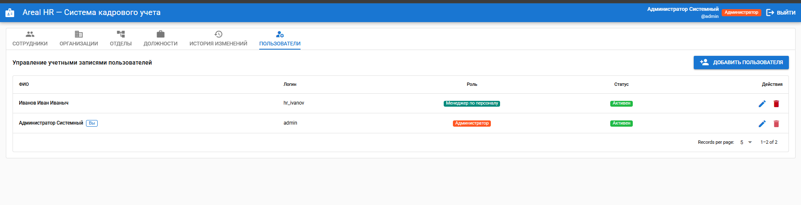
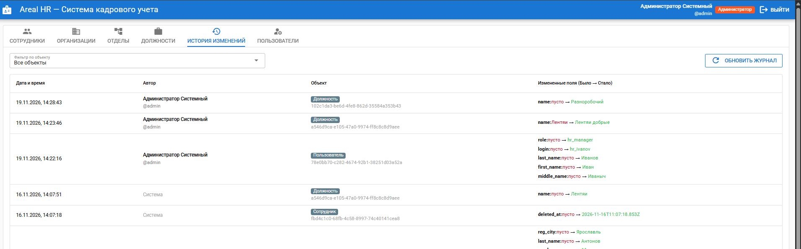

# Areal HR — Система кадрового учета (`areal-hr_ext-test`)

Веб-приложение для специалистов по кадрам: ведение многоуровневой организационной структуры компаний, отделов и должностей, кадровый учет сотрудников со сканами документов, версионирование кадровых перемещений, сквозной аудит изменений и разграничение прав доступа на основе ролей (RBAC).

---

## 1. Стек технологий и инструментарий

* **Операционная система:** Windows 11 Pro (с подсистемой WSL2 / Docker Desktop)
* **Среда разработки (IDE):** Visual Studio Code (с расширениями GitLens, Draw.io Integration, Docker); для визуального инспектирования БД — DBeaver Community
* **СУБД:** PostgreSQL 17 в изолированном Docker-контейнере (`areal_postgres`), порт `5432`
* **Проектирование схемы данных:** Draw.io (исходник: `docs/schema.drawio`, графическая схема: `docs/schema.png`)
* **Backend (`/api`):**
  * Node.js v22 LTS, NestJS v10 (CommonJS)
  * `pg` (сырой пул соединений `pg.Pool`, без ORM) и `node-pg-migrate` (миграции БД)
  * `joi` (валидация входных данных через глобальный `JoiValidationPipe`)
  * `multer` (загрузка и потоковая выдача сканов документов)
  * `@nestjs/passport`, `passport-local`, `express-session` (сессионная аутентификация через HTTP-only cookies, без JWT)
  * `argon2` (хеширование паролей алгоритмом **Argon2id**)
  * `Jest` (юнит-тесты бизнес-логики)
* **Frontend (`/app`):** Vue.js 3.5, Quasar Framework v2, Vite, Axios (`withCredentials: true`)
* **Архитектурный стиль:** REST API (`http://localhost:3000` для API, `http://localhost:9000` для UI)

---

## 2. Внешний вид интерфейса






---

## 3. Схема базы данных

Архитектура базы данных спроектирована в соответствии с техническим заданием и требованиями к мягкому удалению (**Soft Delete** через метку `deleted_at timestamptz`):

* Исходная схема в формате Draw.io: [`docs/schema.drawio`](docs/schema.drawio)
* Экспортированное графическое представление: [`docs/schema.png`](docs/schema.png)

### Основные сущности и ограничения
* **`users`** — системные пользователи с ролями `CHECK (role IN ('admin', 'hr_manager'))`, хешем пароля Argon2id и частичным уникальным индексом `UNIQUE (login) WHERE deleted_at IS NULL`.
* **`organizations`** — организации (`name` уникально среди активных записей `WHERE deleted_at IS NULL`).
* **`departments`** — древовидная структура отделов (`organization_id`, `parent_id` с индексами; частичный уникальный индекс `(organization_id, parent_id, name) NULLS NOT DISTINCT WHERE deleted_at IS NULL`; рекурсивная защита от циклов `A → B → A` через CTE на уровне сервиса).
* **`positions`** — должности (`name` уникально среди активных записей `WHERE deleted_at IS NULL`).
* **`employees`** — сотрудники с паспортными данными (`varchar(4)`, `varchar(6)`, `varchar(7)`) и адресом регистрации.
* **`files`** — каталог загруженных файлов и сканов (`updated_at`, `deleted_at`).
* **`employee_passport_files`** — связующая таблица со сканами паспортов с составным первичным ключом `PRIMARY KEY (employee_id, file_id)`.
* **`personnel_actions`** — журнал кадровых приказов (`hire`, `transfer_dept`, `change_salary`, `fire`) с поддержкой `updated_at` и `deleted_at`.
* **`audit_logs`** — неизменяемый журнал аудита изменений (`entity_type`, `entity_id uuid`, `user_id FK -> users.id`, дельта изменений `changed_fields jsonb` в формате `{"поле": {"old": ..., "new": ...}}`).

---

## 4. Структура проекта

```plaintext
areal-hr_ext-test/
├── api/                                # Серверная часть (NestJS, pg, миграции, тесты)
│   ├── migrations/                     # Файлы миграций базы данных node-pg-migrate
│   ├── src/
│   │   ├── audit/                      # Сквозной аудит изменений (audit_logs)
│   │   ├── auth/                       # Сессионная аутентификация (Passport Local Strategy)
│   │   ├── common/
│   │   │   ├── decorators/             # @Roles(), @CurrentUser()
│   │   │   ├── filters/                # Глобальный фильтр ошибок PostgreSQL (PgExceptionFilter)
│   │   │   ├── guards/                 # AuthenticatedGuard, RolesGuard
│   │   │   └── pipes/                  # JoiValidationPipe
│   │   ├── database/                   # Глобальный модуль пула pg.Pool и валидация env
│   │   ├── departments/                # CRUD отделов и рекурсивная проверка иерархии
│   │   ├── employees/                  # CRUD сотрудников и срез текущего статуса
│   │   ├── files/                      # Загрузка, скачивание и мягкая очистка сканов
│   │   ├── organizations/              # CRUD организаций
│   │   ├── personnel-actions/          # Проведение и отмена кадровых приказов
│   │   ├── positions/                  # CRUD должностей
│   │   ├── users/                      # Управление пользователями (только для admin)
│   │   ├── app.module.ts
│   │   └── main.ts
│   ├── uploads/passports/              # Локальное хранилище загруженных сканов
│   ├── .env
│   └── package.json
├── app/                                # Клиентская часть (Vue 3.5, Quasar, Vite)
│   └── src/
│       ├── boot/axios.js               # Настройка Axios (withCredentials) и перехватчиков 401/403
│       ├── composables/useAuth.js      # Реактивное состояние текущей сессии и роли пользователя
│       ├── layouts/MainLayout.vue      # Шапка с профилем пользователя, ролью и кнопкой выхода
│       ├── pages/
│       │   ├── LoginPage.vue           # Экран авторизации
│       │   └── IndexPage.vue           # Основной рабочий кабинет (вкладки и модальные окна)
│       └── router/                     # Маршруты и навигационные гарды (requiresAuth, guestOnly)
├── containers/                         # Конфигурации контейнеризации (Dockerfile для api и app)
├── docs/                               # Документация, ER-диаграмма и скриншоты интерфейса
│   ├── schema.drawio
│   ├── schema.png
│   ├── ui-preview1.png
│   ├── ui-preview2.png
│   └── ui-preview3.png
├── .env.example                        # Шаблон переменных окружения
├── docker-compose.yml                  # Манифест запуска PostgreSQL 17
├── start-dev.bat                       # Быстрый запуск БД, API и UI в Windows
└── README.md                           # Документация проекта и инструкции
```

---

## 5. Инструкция по запуску и проверке (Quick Start)

### Предварительные требования
1. Установлен и запущен **Docker Desktop** (индикатор движка в левом нижнем углу должен быть зелёным — `Engine running`).
2. Установлена среда выполнения **Node.js** (версия 20 LTS или 22 LTS).

### Шаг 1. Клонирование репозитория и настройка окружения
```bash
git clone [https://github.com/](https://github.com/)<ваш-логин>/areal-hr_ext-test.git
cd areal-hr_ext-test

# Создание локальных файлов .env на основе шаблона (для Windows)
copy .env.example .env
copy .env.example api\.env
```

### Шаг 2. Запуск PostgreSQL 17 в Docker
```bash
docker compose up -d
```
Контейнер `areal_postgres` поднимется на порту `5432`. Проверить статус: `docker ps`.

### Шаг 3. Установка зависимостей, накат миграций и запуск Backend API
В первом окне терминала выполните:
```bash
cd api
npm ci
npm run migrate up
npm run start:dev
```
* **REST API доступен по адресу:** `http://localhost:3000`
* При выполнении `npm run migrate up` создаются все таблицы, индексы и первичный администратор системы.

### Шаг 4. Установка зависимостей и запуск Frontend UI
Во втором окне терминала выполните:
```bash
cd app
npm ci
npm run dev
```
* **Веб-интерфейс Quasar доступен по адресу:** `http://localhost:9000`

*(Для ежедневного запуска в Windows можно также использовать корневой скрипт `start-dev.bat`.)*

---

## 6. Учётные данные для входа и проверка ролевой модели (RBAC)

После применения миграций в системе автоматически доступна учётная запись первичного администратора:

* **Логин:** `admin`
* **Пароль:** `Admin123!`
* **Роль:** Администратор (`admin`)

### Сценарий проверки прав доступа для проверяющего
1. **Вход под администратором (`admin` / `Admin123!`):**
   * В шапке отображаются ФИО, логин `@admin`, бейдж **«Администратор»** и кнопка **«Выйти»**.
   * Доступны все 6 вкладок: **«Сотрудники»**, **«Организации»**, **«Отделы»**, **«Должности»**, **«История изменений»** и **«Пользователи»**.
   * Во вкладке **«Пользователи»** можно создать нового сотрудника с ролью **«Менеджер по персоналу»** (`hr_manager`). Система блокирует удаление собственной учётной записи и снятие прав/удаление последнего администратора.
   * При любых изменениях данных во вкладке **«История изменений»** фиксируется автор операции (`user_id`).
2. **Вход под менеджером по персоналу (`hr_manager`):**
   * После выхода из учётной записи администратора и входа под созданным менеджером вкладка **«Пользователи»** скрывается из интерфейса, а прямые запросы к `/users` отклоняются сервером со статусом `403 Forbidden`.
   * Все разделы кадрового учёта и справочников остаются полностью доступными.

---

## 7. Запуск юнит-тестов бэкенда

```bash
cd api
npm run test
```

---

## 8. Справочник по работе с Git

Все коммиты в репозитории оформляются небольшими логическими порциями по стандарту **Conventional Commits на русском языке**:
* `feat(scope): ...` — добавление нового функционала;
* `fix(scope): ...` — исправление ошибок;
* `refactor(scope): ...` — оптимизация структуры кода без изменения поведения;
* `docs: ...` — обновление документации и схем;
* `test(scope): ...` — добавление и обновление тестов;
* `chore: ...` — настройка конфигурации, зависимостей и окружения.

### Основные консольные команды
```bash
git status                                              # Проверка состояния рабочих файлов
git add <путь_к_файлу>                                  # Добавление файла в индекс
git commit -m "docs: описание изменений"                # Фиксация коммита
git push origin main                                    # Отправка изменений на GitHub
git pull origin main                                    # Получение изменений с GitHub
git log --oneline --graph --decorate -n 10              # Просмотр истории коммитов
```

### Работа с Git в Visual Studio Code (GUI)
1. Открыть панель **Source Control** (`Ctrl + Shift + G`).
2. Нажать **`+`** напротив нужных файлов в списке *Changes* для переноса в *Staged Changes*.
3. Ввести сообщение коммита в верхнее поле и нажать **`Ctrl + Enter`** (или кнопку **Commit**).
4. Нажать **Sync Changes** в строке состояния внизу экрана для отправки коммитов на GitHub.