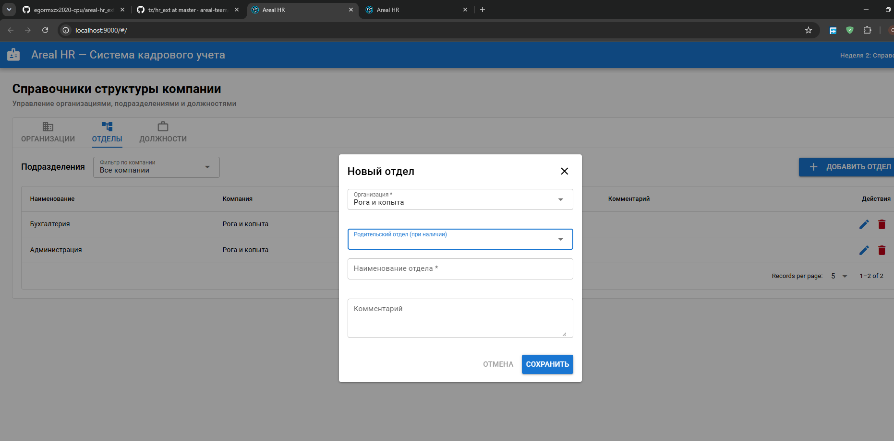

# Areal HR — Система кадрового учета (areal-hr_ext-test)

Веб-приложение для специалистов по кадрам: ведение многоуровневой организационной структуры компаний, отделов и должностей, кадровый учет сотрудников, версионирование кадровых перемещений и аудит изменений.

---

## 1. Стек технологий и инструментарий

* **Операционная система:** Windows 11 Pro (с подсистемой WSL2 / Docker Desktop)
* **Среда разработки (IDE):** Visual Studio Code (с расширениями GitLens, Draw.io Integration, Docker)
* **СУБД:** PostgreSQL 17 в изолированном Docker-контейнере (`areal_postgres`), порт `5432`
* **Проектирование схемы данных:** Draw.io (исходник: `docs/schema.drawio`, графическая схема: `docs/schema.png`)
* **Backend:** Node.js v22 LTS, NestJS 10, pg (сырой пул соединений `pg.Pool`, без ORM по ТЗ), node-pg-migrate, Joi (валидация данных), Argon2id (хеширование паролей)
* **Frontend:** Vue.js 3.5, Quasar Framework v2, Vite, Axios
* **Тестирование:** Jest (юнит-тесты бизнес-логики)
* **Архитектурный стиль:** REST API (`http://localhost:3000` для API, `http://localhost:9000` для UI)

---

## 2. Внешний вид интерфейса



---

## 3. Схема базы данных

Архитектура базы данных спроектирована в соответствии с техническим заданием и требованиями к мягкому удалению (**Soft Delete** через метку `deleted_at timestamptz`):

* Исходная схема в формате Draw.io: [`docs/schema.drawio`](docs/schema.drawio)
* Экспортированное графическое представление: [`docs/schema.png`](docs/schema.png)

### Основные сущности и ограничения:
* **organizations** — организации (`name` уникально среди неудаленных записей `WHERE deleted_at IS NULL`).
* **departments** — древовидная структура отделов (`organization_id`, `parent_id` с индексами; частичный уникальный индекс `(organization_id, parent_id, name) NULLS NOT DISTINCT WHERE deleted_at IS NULL`; рекурсивная защита от циклов `A → B → A` на уровне сервиса).
* **positions** — должности (`name` уникально среди неудаленных записей `WHERE deleted_at IS NULL`).
* **employees** — сотрудники с паспортом и адресом (серия `varchar(4)`, номер `varchar(6)`, код подразделения `varchar(7)`).
* **files** — каталог файлов и сканов (`updated_at`, `deleted_at`).
* **employee_passport_files** — связующая таблица со сканами паспортов с составным первичным ключом `PRIMARY KEY (employee_id, file_id)`.
* **personnel_actions** — журнал кадровых приказов (`hire`, `transfer_dept`, `change_salary`, `fire`) с поддержкой `updated_at` и `deleted_at`.
* **users** — системные пользователи с ограничением ролей `CHECK (role IN ('admin', 'hr_manager'))` и логином `UNIQUE WHERE deleted_at IS NULL`.
* **audit_logs** — неизменяемый журнал аудита изменений (`entity_id uuid`, `changed_fields jsonb`, прямая связь по внешнему ключу только к `users.id`).

---

## 4. Инструкция по первому запуску (Quick Start)

### Предварительные требования
1. Установлен и запущен **Docker Desktop** (индикатор в левом нижнем углу должен быть зеленым — `Engine running`).
2. Установлена среда выполнения **Node.js** (версия 20 LTS или 22 LTS).

### Шаг 1. Клонирование репозитория и настройка переменных окружения
```bash
git clone [https://github.com/](https://github.com/)<ваш-логин>/areal-hr_ext-test.git
cd areal-hr_ext-test

# Создание локального .env на основе шаблона
copy .env.example .env


### Шаг 2. Запуск PostgreSQL 17 в Docker
Bash
docker compose up -d
Проверить статус контейнера можно командой docker ps. Контейнер areal_postgres должен иметь статус Up и проброс портов 0.0.0.0:5432->5432/tcp.

Шаг 3. Инициализация и запуск Backend API
В первом окне терминала выполните:

Bash
cd api
npm ci
npm run migrate up
npm run start:dev
REST API доступен по адресу: http://localhost:3000

Проверка доступности эндпоинтов: http://localhost:3000/organizations, http://localhost:3000/departments, http://localhost:3000/positions

### Шаг 4. Инициализация и запуск Frontend UI
Во втором окне терминала выполните:

Bash
cd app
npm ci
npm run dev
Веб-интерфейс Quasar доступен по адресу: http://localhost:9000

### Шаг 5. Запуск юнит-тестов бэкенда
Bash
cd api
npm run test
Быстрый запуск для Windows (батник)
Для ежедневной разработки в корне проекта подготовлен пакетный файл start-dev.bat. Двойной клик по файлу автоматически проверяет и поднимает PostgreSQL в Docker, а затем открывает два отдельных окна консоли со службами бэкенда и фронтенда.

## 5. Справочник по работе с Git
Все коммиты в репозитории формируются регулярно, небольшими логическими порциями и со строгим соблюдением соглашения Conventional Commits на русском языке:

feat(scope): ... — добавление нового функционала;

fix(scope): ... — исправление ошибок и багов;

refactor(scope): ... — оптимизация структуры кода без изменения поведения;

docs: ... — правки документации, схем и README;

test(scope): ... — добавление или правка тестов;

chore: ... — настройка сборки, пакетов, линтера или конфигурации.

Основные команды Git в консоли (терминале)
Просмотр состояния файлов и рабочего каталога:

Bash
git status
Индексация файлов (Staging):

Bash
git add <путь-к-файлу>       # Добавить конкретный файл в индекс
git add api/                # Добавить директорию бэкенда
git add app/                # Добавить директорию фронтенда
git add .                   # Подготовить все измененные файлы в текущей папке
Фиксация изменений (Commit):

Bash
git commit -m "feat(api): добавление валидации данных через joi"
git commit -m "fix(app): устранение ошибки выпадающего списка отделов"
git commit -m "docs: актуализация er-диаграммы и инструкций"
Отправка локальных коммитов на GitHub:

Bash
git push origin main
Получение и слияние изменений из удаленного репозитория:

Bash
git pull origin main
Работа с ветками:

Bash
git branch                  # Список локальных веток
git checkout -b <имя-ветки> # Создать ветку и переключиться на нее
git checkout main           # Переключиться на основную ветку
Просмотр истории коммитов (компактный граф):

Bash
git log --oneline --graph --decorate -n 10
Работа с Git в графическом интерфейсе Visual Studio Code (GUI)
Панель контроля версий (Source Control): вызывается сочетанием клавиш Ctrl + Shift + G или нажатием иконки ветвления на левой панели активности.

Индексация файлов:

Клик по значку + напротив конкретного файла переносит его в секцию Staged Changes.

Клик по значку + напротив общего заголовка Changes подготавливает все измененные файлы одновременно.

Создание коммита: введите содержательное сообщение коммита в верхнее текстовое поле ввода и нажмите комбинацию клавиш Ctrl + Enter (либо синюю кнопку Commit).

Синхронизация с GitHub: нажмите кнопку Sync Changes со стрелками в строке состояния внизу слева, либо перейдите в меню панели ... ➔ Push / Pull.

Просмотр различий (Diff Viewer): клик по любому файлу в списке изменений открывает параллельное сравнение «до/после» с подсветкой добавленных и удаленных строк.

## 6. Структура проекта
areal-hr-test-2025/
├── api/                             # Серверная часть (NestJS 10, CommonJS)
│   ├── migrations/                  # Миграции структуры базы данных (node-pg-migrate)
│   │   ├── ..._init_orgs_depts_positions.js
│   │   └── ..._add_indexes_and_constraints.js
│   ├── src/                         # Исходный код модулей API
│   │   ├── common/                  # Общие пайпы и утилиты (JoiValidationPipe)
│   │   ├── database/                # Пул соединений PostgreSQL (pg.Pool)
│   │   ├── departments/             # Модуль отделов (CRUD, поиск циклов, юнит-тесты)
│   │   ├── organizations/           # Модуль организаций (CRUD, проверка зависимостей)
│   │   ├── positions/               # Модуль должностей (CRUD, валидация)
│   │   ├── app.module.ts            # Корневой модуль NestJS
│   │   └── main.ts                  # Точка входа API (CORS, порты, запуск)
│   ├── .env                         # Локальная конфигурация переменных бэкенда
│   └── package.json                 # Зависимости и скрипты API
├── app/                             # Клиентская часть (Vue 3.5, Quasar CLI, Vite)
│   ├── src/
│   │   ├── boot/                    # Инициализация плагинов (axios.js с env-адресом)
│   │   ├── layouts/                 # Базовый макет приложения (MainLayout.vue)
│   │   ├── pages/                   # Страницы приложения (IndexPage.vue — справочники)
│   │   └── router/                  # Маршрутизация Quasar
│   ├── .env                         # Локальные переменные фронтенда (VITE_API_URL)
│   └── package.json                 # Зависимости фронтенда
├── containers/                      # Конфигурации контейнеризации (подготовка к этапам 7–8)
│   ├── api/
│   └── app/
├── docs/                            # Документация и проектные схемы
│   ├── schema.drawio                # Исходник ER-диаграммы базы данных
│   ├── schema.png                   # Экспортированная диаграмма в формате PNG
│   └── ui-preview.png               # Скриншот рабочего веб-интерфейса
├── .env.example                     # Шаблон переменных окружения для развертывания
├── .gitignore                       # Список исключений Git (node_modules, .env, build-файлы)
├── docker-compose.yml               # Манифест развертывания PostgreSQL 17
├── start-dev.bat                    # Скрипт быстрого запуска всей инфраструктуры под Windows
└── README.md                        # Главная документация проекта